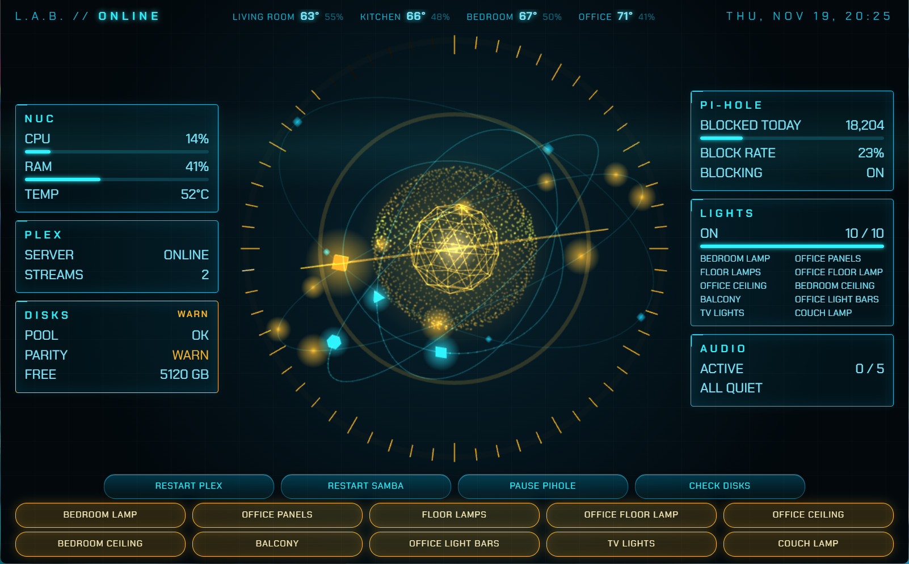
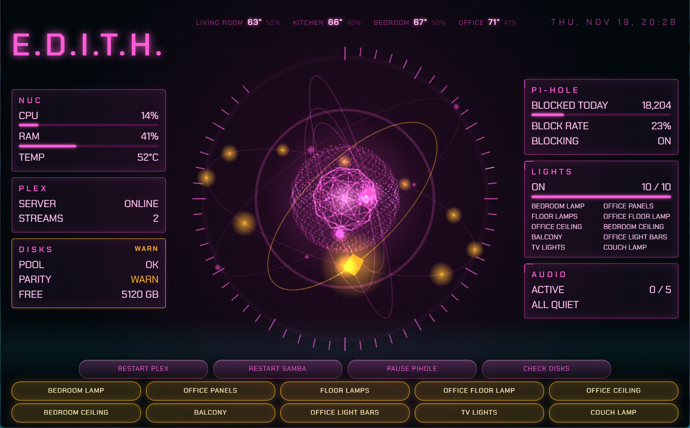
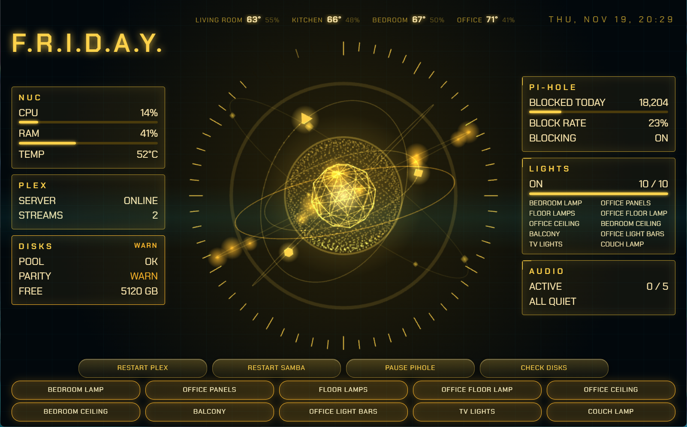
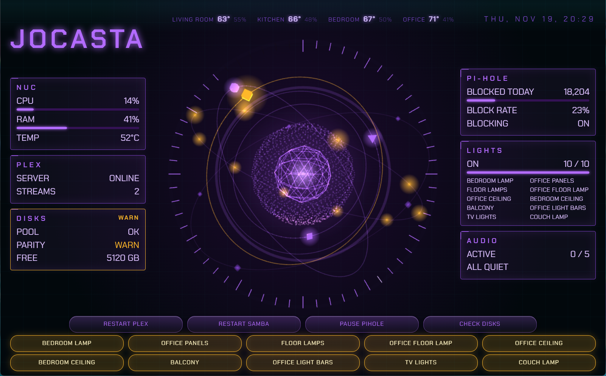
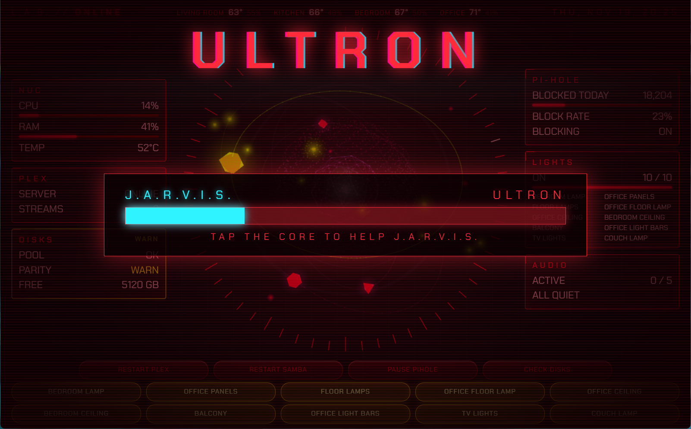
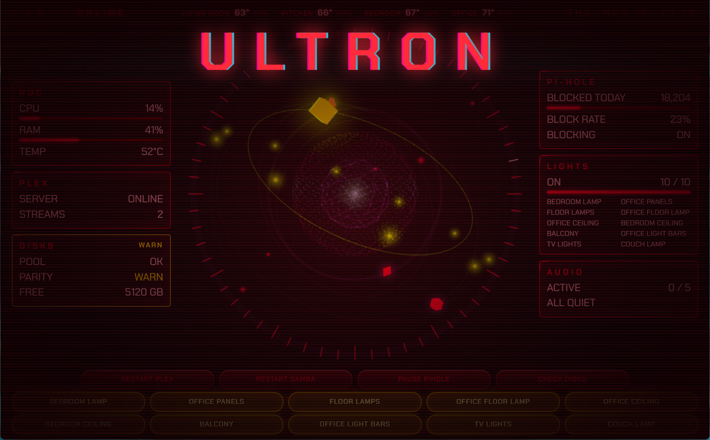
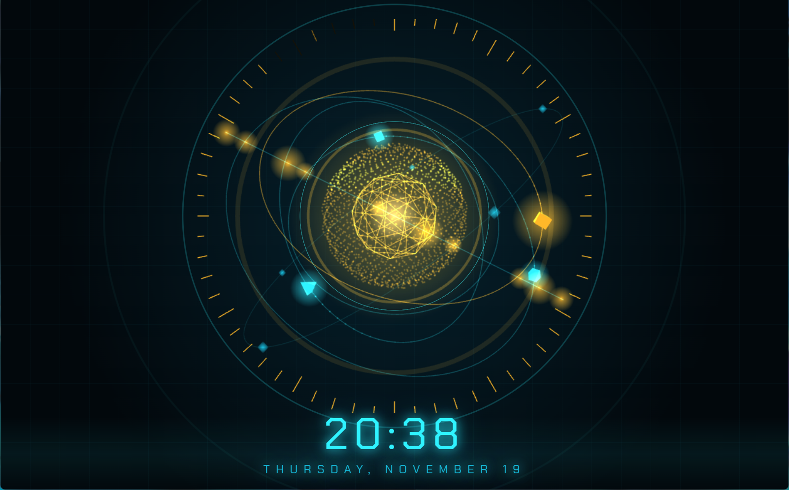
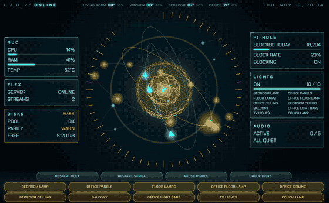

# Jarvis Panel

A living-room, Iron-Man-style touch panel for a homelab. A small FastAPI server watches your gear
(Plex, a NUC, Pi-hole, disks, smart lights, speakers, room temperatures) and a full-screen browser
page shows it as a glowing 3D holographic core with spoken alerts, a local AI butler, and a few
silly easter eggs. Built as a fun project, not a utility.

A *Lonely Guy Gadgets* build. Not affiliated with Marvel or Disney: J.A.R.V.I.S., E.D.I.T.H.,
F.R.I.D.A.Y., JOCASTA and Ultron are fan-made personas written from scratch.

## What it does

- **Live status** of the NUC, Plex streams, disk array, Pi-hole and smart home on one screen.
  Problems are spoken once, when they change, never nagged.
- **3D holo-core** (three.js) that reacts to health, to the music playing, and to the room's sound.
- **Controls:** restart Plex/Samba, pause Pi-hole, toggle lights, speaker volume and play/pause,
  room temperatures from Bluetooth sensors. Every action is an allow-listed command in `config.toml`.
- **Local AI butler** (Ollama): tap the core three times for a quip. It can only talk, never act.
- **Guest AIs and a takeover:** E.D.I.T.H., F.R.I.D.A.Y. and JOCASTA each take over for 8-12 minutes
  with their own voice and personality. Ultron stages a fight you can win by tapping, and blinks the
  real lights red, then puts each one back as it was: on or off, in its own colour.
- **Voice hand-over:** say "Jarvis, let me talk to EDITH" (or FRIDAY, JOCASTA, Ultron) and that AI takes over and keeps the
  panel until you ask for Jarvis or another AI. Asking for Ultron is not a fight, so the room lights stay put. The AI in control
  answers to its own name as well as "Jarvis", and everything resets to Jarvis when the system restarts.
- **Spoken boot briefing:** after the greeting, Jarvis reads out where every monitored system stands.
- **Lots of variety:** 20 arrival lines per guest and 30 Ultron battles, all plain text files in `jarvis/lines/`.
- **Mute:** a speaker icon in the top bar, or "Jarvis, mute" / "Jarvis, unmute".
- **Idle screensaver clock**, 24-hour time everywhere, 10 colour themes, 6 fonts, 6 button styles.

### Touch guide (on the core)

| Gesture | Result |
|---|---|
| 3 taps | the AI in control makes a remark |
| 4 taps | a guest AI takes over |
| 5 taps | party mode |
| 6 taps | the tour: every AI in turn, then an Ultron fight |
| 7 taps | boot sequence |
| 9 taps | Ultron takeover |
| long press (about 2 s) | sends a guest or Ultron away, brings Jarvis back, and cancels a running tour |

Test URLs: `?guest=edith|friday|jocasta`, `?tour`, `?ultron`, `?reign`, `?idle=5`, `?noboot`.

## Screenshots



| E.D.I.T.H. | F.R.I.D.A.Y. | JOCASTA |
|---|---|---|
|  |  |  |

| Ultron fight | Ultron reigns | Idle clock |
|---|---|---|
|  |  |  |



[Full tour recording with sound (MP4)](docs/tour.mp4) · All screenshots use the built-in mock data.

## Documentation

The full story, architecture, voice and lights design, configuration and lessons learned are in the
**[wiki](https://github.com/LonelyGuyGadgets/jarvis-panel/wiki)**.

## Architecture

```
browser (kiosk)  <--poll /api/status-->  FastAPI server (jarvis/)  -->  Plex, Pi-hole, Home Assistant,
  web/*.js, three.js                       app.py, sources/, ...          Govee cloud, Piper TTS, Ollama
```

- `jarvis/` Python server: data sources, allow-listed actions, voice (Piper TTS, cached per phrase),
  brain (Ollama), guests, Ultron show.
- `web/` the panel: plain JS, no build step. Pure logic lives in `web/logic.js` with tests.
- `deploy/` systemd unit, kiosk launcher, setup scripts.
- `dev_server.py` runs the panel on your PC against mock data for design work.

## Run it

```bash
python -m venv .venv && .venv/bin/pip install -r requirements.txt
cp secrets.example.toml secrets.toml   # fill in your own keys; never commit this file
# edit config.toml: addresses, lights, sensors (the values here are placeholders)
python run.py                          # serves on the bind_host:port in config.toml
python dev_server.py                   # or: mock-data preview on 127.0.0.1:8099
```

Voice needs [Piper](https://github.com/rhasspy/piper) and voice models, which are not included:
download them from the Piper voices page and point `[voice]` and `[voice.models]` in `config.toml`
at them. Respect each model's own licence.

## Make it yours

- `[owner] name` in `config.toml` is how the AIs address you in every spoken line and AI reply
  (the default is "Boss"). Voice lines are cached, so delete the `voice-cache` folder after changing it.
- `[smart_home]`, `[govee_cloud]`, `[climate]` list your lights, plugs and Bluetooth sensors.

## Tests

```bash
python -m pytest -q
node --test web/logic.test.js
```

## Security notes

- The browser can only ask for fixed spoken phrases or allow-listed actions, never arbitrary text or commands.
- The AI brain has no way to run actions.
- Keep the panel on your LAN. It has no login.
- API keys belong in `secrets.toml` (git-ignored), never in `config.toml`.

## Licence

MIT, see `LICENSE`.

## The homelab behind it

The panel watches a small home server for media, photos, music, ebooks and home automation. The [homelab](homelab/) folder and the [Homelab overview](https://github.com/LonelyGuyGadgets/jarvis-panel/wiki/Homelab-Overview) wiki pages describe how to build one like it.
